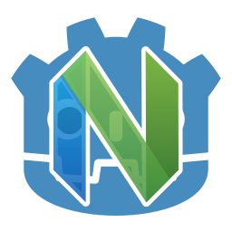

<p align="center">
  
</p>

<h1 align="center">godot-neovim</h1>

<p align="center">
  Godot editor plugin that uses Neovim as the backend for script editing.<br>
  Inspired by <a href="https://github.com/vscode-neovim/vscode-neovim">vscode-neovim</a> and <a href="https://github.com/hmdfrds/godot-vim">GodotVim</a>.
</p>

## Overview

godot-neovim brings Neovim editing to Godot's script editor using a real Neovim process. Edit in Godot while keeping its native completion and IME support.

- Vim motions, operators, text objects, registers, and macros
- Godot integration for saving, navigating files, folding, and documentation
- Custom key bindings and support for undocked script editors

Insert mode uses Godot's native text input, so behavior differs from standalone Neovim. See [limitations and known issues](docs/limitations.md).

## Requirements

- Godot 4.4 or later
- Neovim 0.9.0 or later, installed on your computer
- Windows (x64), Linux (x64 or ARM64), or macOS (Intel or Apple Silicon)

Rust is only required to [build from source](docs/development.md#build-from-source).

## Install

### From the Godot Asset Store

1. Open the Asset Store in the Godot editor.
2. Search for **godot-neovim** by **shiena** ([asset page](https://store.godotengine.org/asset/shiena/godot-neovim/)).
3. Download and install the addon into your project.

Continue with [Enable the plugin](#enable-the-plugin). Neovim must be installed separately.

### From GitHub Releases

1. Download the package for your platform from [Releases](https://github.com/shiena/godot-neovim/releases).
2. Extract the addon into your project's `addons/godot-neovim/` directory.

### Enable the plugin

1. On macOS, remove the quarantine attribute before enabling the plugin:

   ```bash
   xattr -rc addons/godot-neovim
   ```

2. Enable **godot-neovim** in **Project > Project Settings > Plugins**.

If Neovim isn't found, set **Neovim Executable Path** in **Editor > Editor Settings > Godot Neovim**. Enable **Advanced Settings** to see the settings.

## Start editing

1. Open a script in Godot. The mode indicator shows the current Neovim mode.
2. Press `i` to enter Insert mode and edit with Godot's completion.
3. Press Escape or `Ctrl+[` to return to Normal mode.

Use your usual Vim motions and editing commands. `:w` saves through Godot, and `:q` closes the current editor tab.

For help, run `:help` or press F1 and search for **GodotNeovim**. The full [command reference](docs/commands.md) is available separately.

## Configure your workflow

| To | Do this |
|---|---|
| Use go to definition (`gd`) | Enable **Use Thread** under **Editor Settings > Network > Language Server**. |
| Customize key bindings | Open the **Neovim Keymaps** dock. |
| Load your Neovim configuration | Turn off **Neovim Clean** in **Editor Settings > Godot Neovim**. Some plugins can conflict with Godot integration. |

By default, **Neovim Clean** is enabled, so your `init.lua` and plugins aren't loaded. Keep this enabled when checking whether a problem comes from your Neovim configuration.

See [configuration and key mappings](docs/configuration.md) for settings, screenshots, and keymap import instructions.

## Export your game

This is an editor-only addon. Exclude it from every export preset to prevent extension-loading errors in the exported game:

1. Open **Project > Export** and select a preset.
2. Open the **Resources** tab.
3. Add `addons/godot-neovim/*` to **Filters to exclude files/folders from project**.

See [export details](docs/exporting.md) for error examples and the reason to use this filter.

## Troubleshooting and limitations

- **Neovim doesn't start:** Check **Neovim Executable Path** and the required Neovim version.
- **`gd` asks for Use Thread:** Enable the language server setting described in [configuration](docs/configuration.md#enable-go-to-definition).
- **Neovim stops responding:** Use the recovery dialog to restart its connection.
- **An editing command behaves differently:** Check [limitations and known issues](docs/limitations.md), especially native Insert mode and modifier keys.

## More information

- [Command reference](docs/commands.md)
- [Configuration and key mappings](docs/configuration.md)
- [Limitations and known issues](docs/limitations.md)
- [Build instructions, architecture, and roadmap](docs/development.md)
- [Comparison with GodotVim](docs/comparison.md)

## Contribute

Report issues or submit pull requests on [GitHub](https://github.com/shiena/godot-neovim). See the [development guide](docs/development.md) to build from source.

## Disclaimer

This project is not affiliated with, endorsed by, or sponsored by the [Godot Foundation](https://godot.foundation/) or the [Neovim](https://neovim.io/) project.

- "Godot" and the Godot logo are registered trademarks of the Godot Foundation.
- "Neovim" and the Neovim logo are trademarks of their respective owners. The Neovim logo is licensed under [CC BY 3.0](https://creativecommons.org/licenses/by/3.0/) by Jason Long.

## License

Licensed under either of

* Apache License, Version 2.0 ([LICENSE-APACHE](LICENSE-APACHE) or http://www.apache.org/licenses/LICENSE-2.0)
* MIT license ([LICENSE-MIT](LICENSE-MIT) or http://opensource.org/licenses/MIT)

at your option.

### Contribution

Unless you explicitly state otherwise, any contribution intentionally submitted
for inclusion in the work by you, as defined in the Apache-2.0 license, shall be
dual licensed as above, without any additional terms or conditions.
