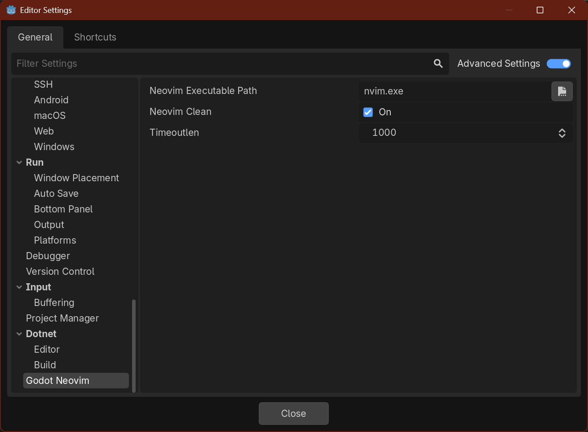
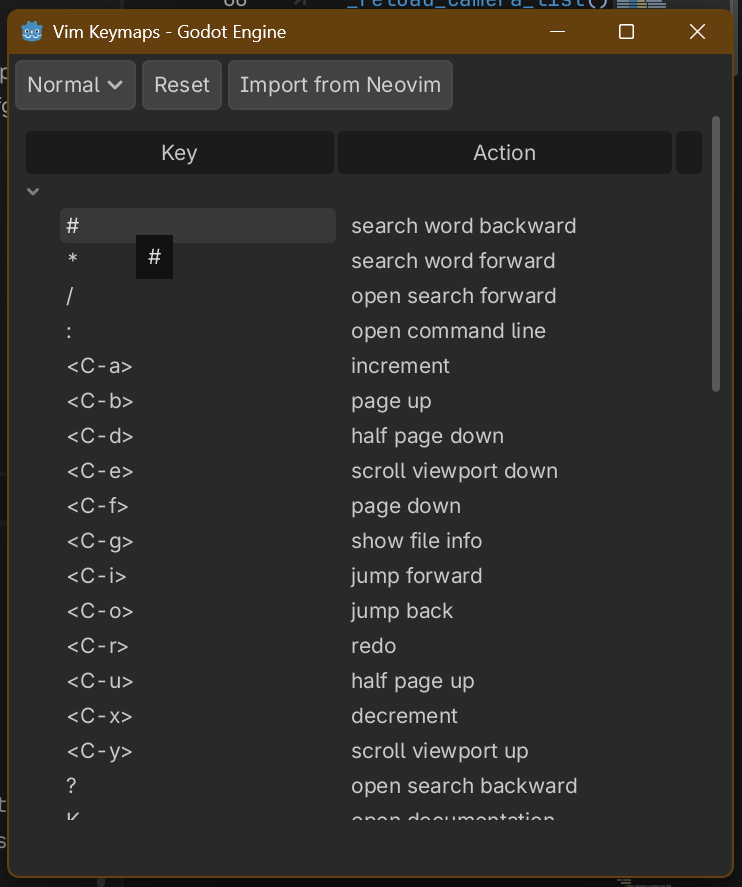

# Configure godot-neovim

[Back to README](../README.md)

All settings are available in **Editor > Editor Settings > Godot Neovim**.

> **Note**: You need to enable **"Advanced Settings"** toggle in the Editor Settings to see the `godot_neovim` section.

  

| Setting | Description | Default |
|---------|-------------|---------|
| Neovim Executable Path | Path to Neovim executable. The plugin validates this path on startup. | `nvim.exe` (Windows) / `nvim` (macOS/Linux) |
| Neovim Clean | Equivalent to the `--clean` startup option. When enabled, Neovim starts without loading any config files (init.lua, plugins, etc.). Recommended to keep enabled to avoid plugin compatibility issues. | true |
| Timeoutlen *(advanced)* | Time in milliseconds to wait for a mapped key sequence to complete. This setting appears when "Advanced Settings" is enabled in Editor Settings. | 1000 |

## Enable go to definition

The `gd` command uses Godot's built-in LSP server for accurate navigation. To enable this feature:

1. Open **Editor > Editor Settings**
2. Navigate to **Network > Language Server**
3. Enable **Use Thread** option

When this setting is disabled, `gd` will show a message prompting you to enable it.

## Customize key mappings

The **Neovim Keymaps** dock panel allows you to customize key bindings without recompiling the plugin. The panel appears in the right dock area (alongside Inspector, Node, etc.) when the plugin is active.

  

**Features:**
- View all current key bindings for Normal and Visual modes
- Edit key bindings by double-clicking the Key column
- Delete bindings with the `Delete` key
- Reset to defaults with the **Reset** button
- Import keymaps from Neovim with the **Import from Neovim** button (requires `neovim_clean = false` for user keymaps)
- Assign keys to actions that have no default binding (such as **save**): these appear at the end of the list with an empty Key column. Double-click the Key column to assign a key, for example `<C-s>` on Windows/Linux or `<D-s>` on macOS

**Key format** follows Neovim notation:
- Single characters: `a`, `A`, `/`, `$`, etc.
- Control combinations: `<C-a>`, `<C-f>`, etc.
- Cmd combinations (macOS): `<D-s>`, etc.
- Special keys: `<CR>`, `<Esc>`, `<Tab>`, `<BS>`, etc.
- Key sequences: `gd`, `zo`, `ZZ`, `[[`, etc.

**Validation:**
- Only valid Neovim key notation is accepted
- Duplicate keys within the same mode are rejected

Custom mappings are persisted in `Editor Settings` under `godot_neovim/custom_keymaps` and survive editor restarts. Custom overrides are marked with `*` in the panel.

> **Note**: Not all keys are customizable through the panel. Keys handled internally by the Neovim state machine (count prefixes, pending operations like `f`/`t`/`r`, register selection `"`, macro recording `q`/`@`, and operators `>`/`<`) are managed by the plugin's Rust backend.
